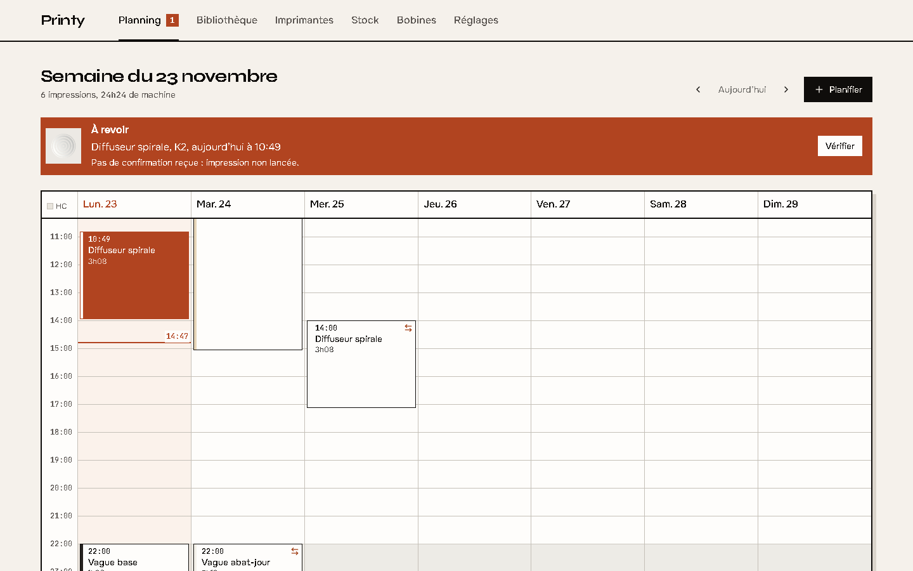
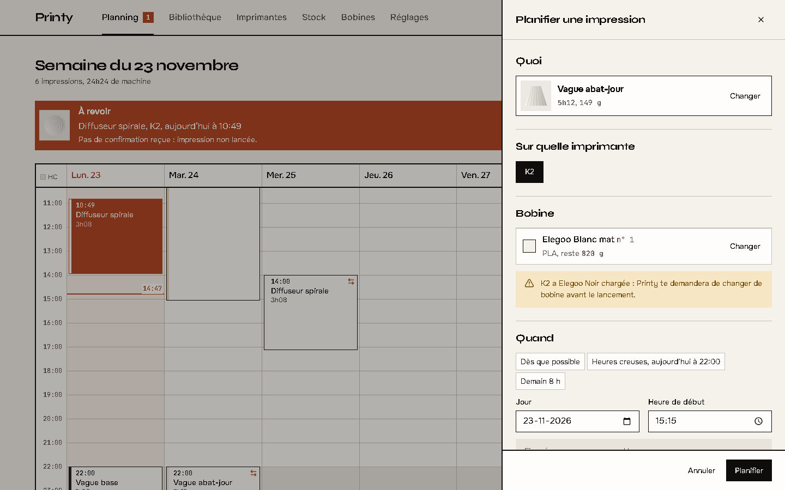
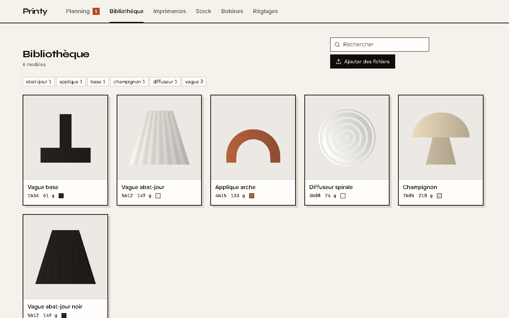
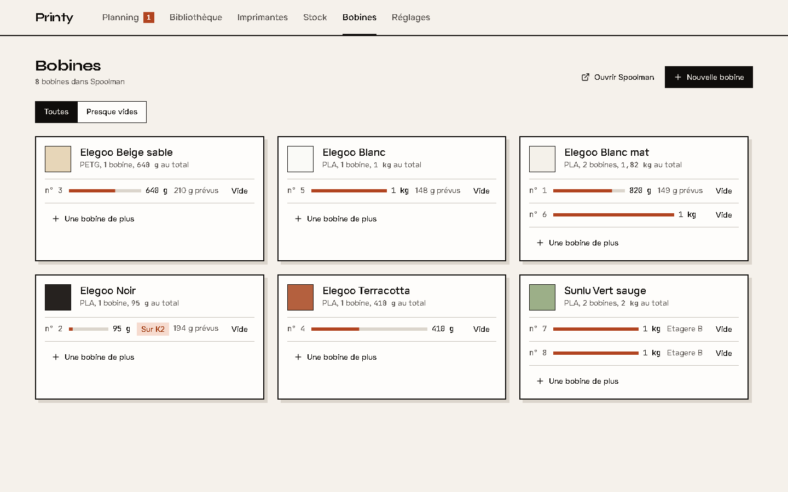
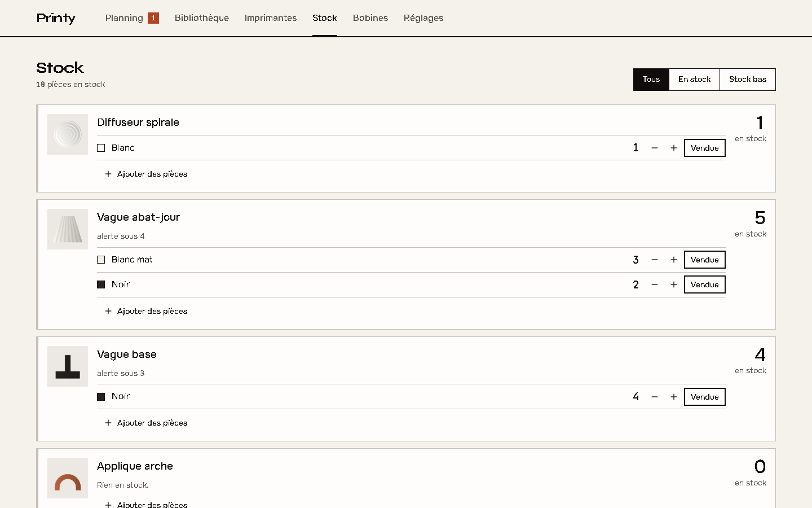
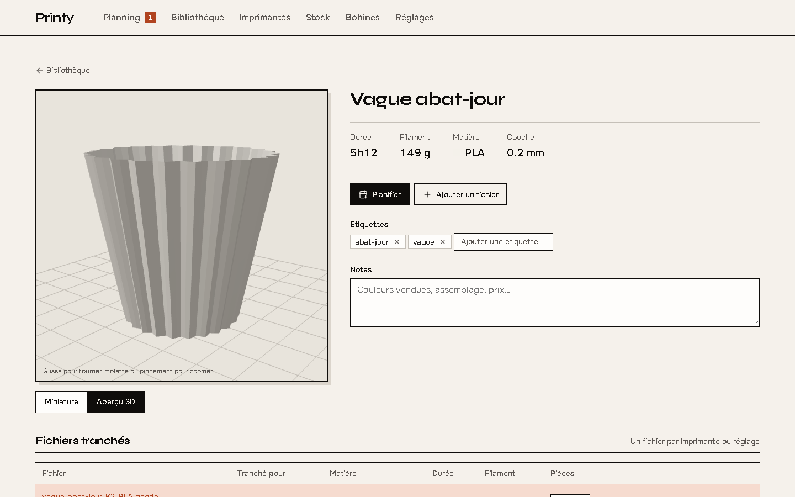
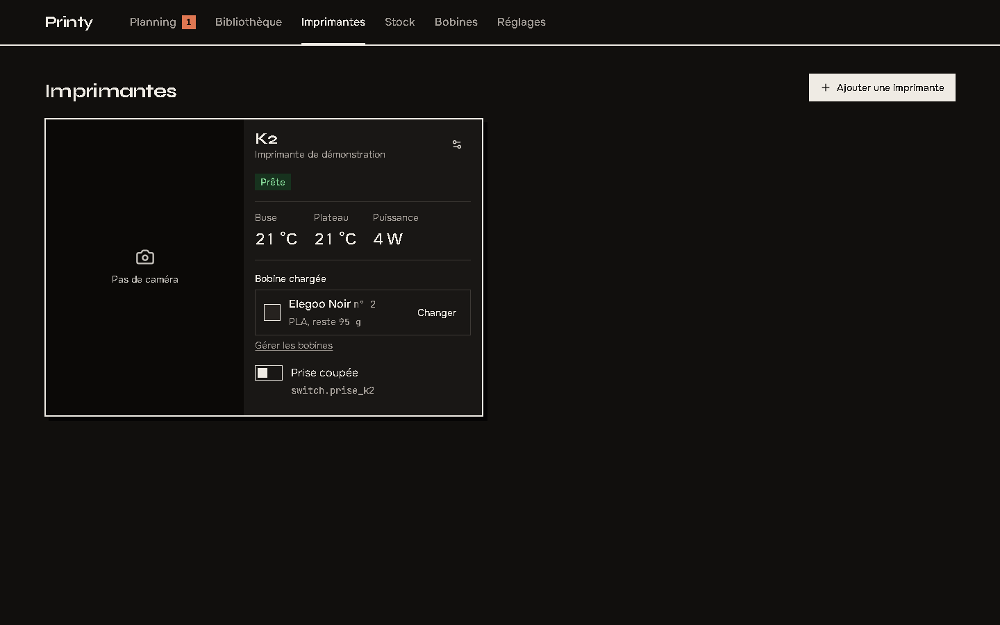
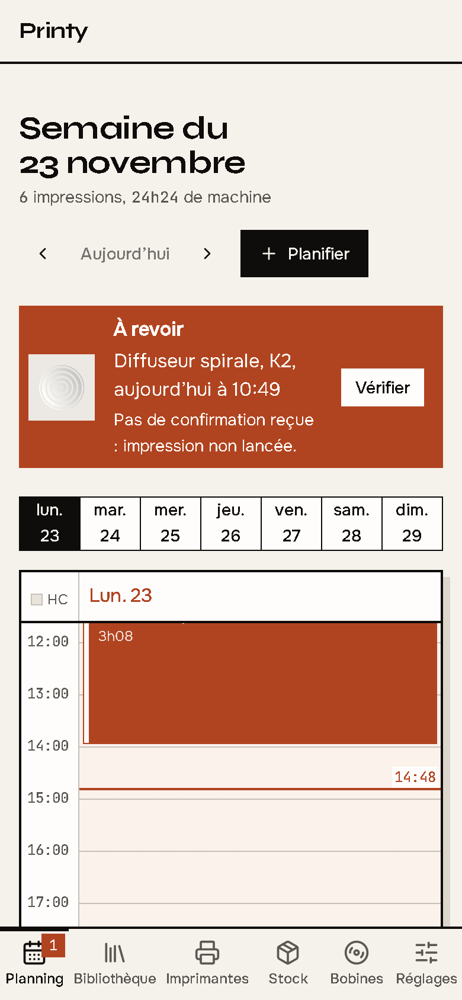

<h1 align="center">Printy</h1>

<p align="center">
  <strong>Un add-on Home Assistant pour piloter un petit atelier d’impression 3D.</strong><br />
  Bibliothèque de fichiers, planning de la semaine, prises connectées, photo du plateau avant chaque lancement, bobines Spoolman et stock.
</p>

<p align="center">
  
</p>

---

## Pourquoi Printy

Imprimer en petite série, c’est surtout de l’organisation : quel fichier sur quelle
imprimante, à quelle heure, avec quelle bobine, et ne jamais lancer une impression sur une
pièce oubliée. Printy s’installe dans Home Assistant et s’occupe de tout ce qui se passe
autour de l’imprimante :

1. **Tu planifies** une impression dans la semaine, idéalement en heures creuses.
2. **Printy allume la prise** de l’imprimante quelques minutes avant.
3. **Tu reçois une notification** avec la photo du plateau : *Lancer*, *Reporter d’1 h*
   ou *Annuler*.
4. **L’impression démarre**, Printy suit la progression et le temps restant.
5. **À la fin**, une notification te prévient ; les pièces entrent dans le stock.
6. **La prise est coupée** une fois la buse et le plateau refroidis.

## Ce qu’il sait faire

<table>
  <tr>
    <td width="50%"></td>
    <td width="50%"></td>
  </tr>
  <tr>
    <td><strong>Planifier en trois questions</strong> : quoi, sur quelle imprimante, quand. Printy
    propose la bonne bobine, affiche la fin prévue et la part en heures creuses.</td>
    <td><strong>Une bibliothèque qui se remplit seule</strong> : miniature, durée, filament,
    couleur et matière lus dans les fichiers d’Orca Slicer, versions regroupées par modèle.</td>
  </tr>
  <tr>
    <td></td>
    <td></td>
  </tr>
  <tr>
    <td><strong>Bobines Spoolman</strong> : ce qu’il reste sur chaque bobine, création en un clic,
    rappels de changement de bobine, synchronisation avec Klipper.</td>
    <td><strong>Stock par produit</strong> : les pièces arrivent seules à la fin de chaque
    impression réussie, rangées par couleur ; ventes et corrections en un clic.</td>
  </tr>
  <tr>
    <td></td>
    <td></td>
  </tr>
  <tr>
    <td><strong>Aperçu 3D</strong> des STL et 3MF, simplifié automatiquement pour les gros
    fichiers ; les sources <code>.blend</code> et <code>.step</code> sont rangées avec le modèle.</td>
    <td><strong>Imprimantes</strong> : caméra, températures, puissance, prise, bobine montée.
    Thème clair ou sombre.</td>
  </tr>
</table>



### En détail

- **Planning** : semaine par imprimante, glisser-déposer pour déplacer (avec annulation),
  heures creuses, impression en cours affichée même lancée hors Printy, conflits signalés.
- **Confirmation du plateau** : photo de la caméra de l’imprimante ou d’une caméra Home
  Assistant ; « Plateau vidé » à la fin d’une impression vaut confirmation pour la suivante.
- **Import** : glisser-déposer n’importe où, envoi direct depuis Orca Slicer (Printy se
  présente comme un serveur OctoPrint), ou dossier surveillé en Samba.
- **Spoolman** : choix de la bobine selon la couleur, la matière et ce qu’il reste (les
  bobines entamées passent avant les neuves), alerte de filament insuffisant, rappels le
  matin et à la fin de l’impression précédente, consommation déduite.
- **Home Assistant** : entités `sensor.printy_*` (état, progression, temps restant, fin et
  prochaine impression, stock) par MQTT Discovery, notifications actionnables.
- **Électricité** : kWh mesurés par la prise, moyenne par pièce.
- **Sur téléphone** : barre d’onglets en bas, planning jour par jour, pensé pour
  l’application compagnon.

<br clear="right" />

## Imprimantes

| Modèle | Prise en charge |
|---|---|
| Creality K2 / K1 (Creality OS) | État et commandes par le WebSocket local, envoi des fichiers par Moonraker. Protocole non documenté par Creality : en cours de validation. |
| Klipper (Moonraker) | API documentée : K2 rootée, Voron, Prusa sous Klipper… |
| Démonstration | Imprimante simulée pour essayer Printy sans matériel. |
| Bambu Lab | Prévu (MQTT local et FTPS, mode LAN). |

Ajouter une marque revient à écrire un pilote : une classe Python avec `status`, `upload`,
`start`, `pause`, `resume`, `cancel` et `snapshot` (voir `printy/backend/printy/drivers`).

## Installation

Printy demande **Home Assistant OS** ou **Supervised** (c’est un add-on).

1. **Paramètres → Modules complémentaires → Boutique → ⋮ → Dépôts**, ajoute :
   ```
   https://github.com/lucasbalon/printy
   ```
2. Installe **Printy**, démarre-le, active **Afficher dans la barre latérale**.
3. Dans Printy :
   - **Imprimantes → Ajouter** : adresse IP, prise connectée, caméra ;
   - **Réglages → Notifications** : coche ton téléphone (application compagnon) ;
   - facultatif : adresse de **Spoolman**, add-on **Mosquitto** pour les entités.

La documentation complète de l’add-on est dans [`printy/DOCS.md`](printy/DOCS.md) (elle
s’affiche aussi dans l’onglet Documentation de l’add-on).

### Envoyer depuis Orca Slicer

Dans Orca : imprimante physique, type **Octo/Klipper**, agent **Orca**, adresse
`http://<home-assistant>:5300`, clé API copiée depuis **Réglages → Import des fichiers**.
Le bouton d’envoi d’Orca dépose alors le fichier dans la bibliothèque de Printy ; rien
n’est envoyé à l’imprimante.

## Développer

Sans Home Assistant, Printy tourne en mode développement : données dans `.dev/`, prises
simulées, notifications journalisées, imprimante de démonstration.

```bash
# backend (Python 3.12+)
python -m venv .venv
.venv/Scripts/pip install -r printy/backend/requirements.txt pytest   # Windows
cd printy/backend
PRINTY_DEV_DIR=../../.dev ../../.venv/Scripts/python -m uvicorn printy.main:app --port 8099 --reload
../../.venv/Scripts/python scripts/seed_demo.py        # données de démonstration

# interface (Vue 3 + Vite), proxy /api vers :8099
cd printy/frontend
npm install
npm run dev
```

- Tests : `cd printy/backend && ../../.venv/Scripts/python -m pytest`
- Build de l’interface : `npm run build` (servie ensuite par FastAPI)
- Diagnostic d’une Creality K2 (lecture seule) : `python scripts/k2_probe.py <ip>`

```
repository.yaml          dépôt d’add-ons Home Assistant
printy/                  l’add-on (config.yaml, Dockerfile, run.sh, DOCS.md)
  backend/printy/        FastAPI, SQLAlchemy, SQLite
    drivers/             un pilote par marque
    scheduler.py         cycle de vie des impressions planifiées (boucle, confirmation, lancement, suivi)
    job_ops.py           actions sur une impression (confirmer, reporter, annuler…) et journal
    reminders.py         rappels : bobines du matin, pièce oubliée sur le plateau
    power.py             coupure de la prise une fois l’imprimante refroidie
    usage.py             consommation de filament déduite dans Spoolman
    photos.py            photos du plateau pour les notifications
    ha.py, ha_entities.py   Home Assistant (prises, caméras, notifications, entités)
    spoolman.py          bobines, choix de bobine, plan de filament
  frontend/src/          Vue 3, TypeScript
docs/SPEC.md             cahier des charges et feuille de route
```

## Feuille de route

- [x] **V1** : bibliothèque, imprimantes, planning, cycle complet avec confirmation photo
- [x] **V2** : Spoolman, rappels de bobine, aperçu 3D, thème sombre
- [x] **V3** : stock par produit, kWh par pièce, entités Home Assistant
- [ ] **V4** : kits (une lampe = plusieurs pièces), pilote Bambu Lab, CFS, file d’attente, commandes clients
